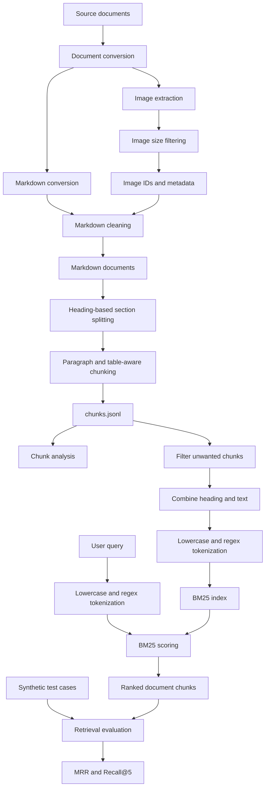

# DAKI5_GR1 – IT Support RAG

A retrieval-augmented generation system for internal IT support.

## Current implementation
- Document conversion and image extraction
- Structure-aware and table-aware chunking
- BM25 retrieval
- Retrieval evaluation
- Initial BGE-M3 embedding experiments

## In development
- Semantic retrieval
- Hybrid retrieval
- LLM-based answer generation
- Extended evaluation

## Current pipeline architecture

